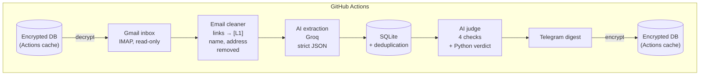

# Job Radar AI

[](https://github.com/ammar-alsharai/job-radar-ai/actions/workflows/tests.yml)

An AI agent that reads job-alert emails every day, turns them into one clean, deduplicated list, judges each job against a profile, and sends a short digest to Telegram — running on its own in GitHub Actions.

## What it does

- **Reads** the job-alert emails that arrived in a dedicated Gmail inbox (via IMAP, read-only).
- **Extracts** every listed job with an AI model into structured data: title, company, location, language, seniority, salary, snippet and link.
- **Removes duplicates**, also when the same job arrives from different job sites.
- **Judges** each new job against a profile: suitable for a junior? Reachable location? Matching skills?
- **Sends** one Telegram digest with the matches and the jobs worth a second look.
- **Runs daily** on GitHub Actions, with the database stored encrypted between runs.

Example digest (made-up jobs):

```
💼 Job Radar: 9 new jobs (2 match, 3 unclear, 4 skipped)

🟢 Match
Junior Data Engineer · Northwind Data · Rotterdam
↳ Junior data engineering role in English, within reach by train.
Python Developer (Graduate) · Contoso Software · Den Haag
↳ Graduate backend role using Python; English working language.

🟡 Unclear
AI Engineer · Fabrikam Insurance · Den Haag
↳ Clear AI role, but no information about seniority or language.
Data Analist · Gemeente Voorbeeld · Leiden
↳ Dutch listing; unclear whether fluent Dutch is required.
Software Engineer · Tailspin Labs · Remote
↳ Software role, but experience level not stated.
```

In Telegram, each title is a link to the job page.

## How it works



Every run reads the recent alert emails, skips the ones that were already processed, and sends only jobs that were not sent before. The state (jobs, verdicts, what was sent) lives in a SQLite database that is encrypted before it is stored in the GitHub Actions cache and decrypted at the start of the next run.

## Design decisions

**Email alerts instead of scraping.** Job sites forbid automated collection in their terms. Instead, the agent reads the alert emails the sites send anyway, and it never opens job links. Alerts are kept broad; the AI does the narrowing.

**Privacy by design.**
- The agent uses a **separate job-alerts inbox**, using a separate Gmail account that only receives job alerts so it never touches personal email.
- Before any text goes to the AI, every **link is replaced by a short code** like `[L1]`. The AI answers with codes and the real URLs are looked up locally, so the AI never sees tracking links.
- The inbox **address and the owner's name are removed** from the text.
- The AI provider (Groq) is used with **Zero Data Retention** enabled.
- In GitHub Actions the program prints **counts only**: no senders, subjects, job titles, reasons or links, because logs of public repositories are public.
- The database is stored **encrypted** (Fernet), because Actions caches and artifacts of a public repository can be read by others. No artifacts are uploaded at all.

**The AI answers facts, Python decides.** The judge does not give a verdict. It answers four questions with `yes`, `no` or `unknown`: junior level, location and skills. One small, tested Python rule turns those into the verdict: any `no` means skip, all `yes` means match, everything else is unclear. The rule is predictable and easy to change.

**"Yes" needs evidence.** Missing information is `unknown`, never `yes`. A listing with only a title ("AI Engineer · Company · City") says nothing about seniority or language, so it ends up as 🟡 unclear instead of a false 🟢 match.

**Completeness check.** Models sometimes skip listings in long emails. The AI first reports how many listings it sees (`listings_seen`), then extracts them. If fewer jobs come back, the request is retried once and the more complete answer is kept.

**Provider-independent AI.** The code uses the `openai` package against any OpenAI-compatible API. Switching provider (for example to Mistral) is a configuration change: base URL, model and key.

**Rate limits without losing work.** Free AI tiers have limits. When a limit is reached, the run stops calling the AI, sends what was already judged with a "⏳ N jobs are waiting" line, and a later run continues where it stopped. Nothing is marked as sent until its Telegram message arrived.

## Known limitations

- Some job sites only include a few jobs per alert email, so the agent can only see those.
- Title-only listings cannot be judged fully: they usually end up as 🟡 unclear.
- AI answers can vary slightly between runs for borderline jobs.
- GitHub's schedule can start runs hours late (or skip one); the backup run helps, but timing is not exact.
- In a public repository, GitHub disables scheduled workflows after 60 days without repository activity.
- The free Groq tier has a daily token limit; on busy days some jobs follow in the next digest.

## Run it yourself

### Locally

```bash
python -m venv .venv
# Windows: .venv\Scripts\activate    macOS/Linux: source .venv/bin/activate
pip install -r requirements-dev.txt
```

1. Copy `.env.example` to `.env` and fill in your own values (job-alerts Gmail with an app password, AI provider, Telegram bot).
2. Copy `profile.example.txt` to `profile.txt` and describe your target roles and skills. Keep it short and leave out personal details: it is sent to the AI.

Useful commands:

| Command | What it does |
|---|---|
| `python main.py --test-telegram` | Send a test message to check the bot and chat ID |
| `python main.py --days 3 --no-ai` | Only read and save the emails of the last 3 days |
| `python main.py --preview 35` | Show the cleaned text that would be sent to the AI for email 35 (no AI call) |
| `python main.py --days 3 --no-send` | Full run, but print the digest instead of sending it |
| `python main.py --days 3` | Full run: read, extract, store, judge and send |
| `python main.py --stats` | Database statistics: jobs per site and per verdict |
| `python main.py --rejudge` | Judge all jobs again (after changing the profile) |

Run `python main.py --help` for all options.

### On GitHub Actions

The daily workflow is `.github/workflows/daily.yml`.

1. Generate a key for the database encryption and keep it in a password manager:
   ```bash
   python -c "from cryptography.fernet import Fernet; print(Fernet.generate_key().decode())"
   ```
2. Add these repository secrets (*Settings → Secrets and variables → Actions*):

   | Secret | Content |
   |---|---|
   | `JOB_EMAIL_ADDRESS` | Job-alerts Gmail address |
   | `JOB_EMAIL_APP_PASSWORD` | Its Gmail app password |
   | `AI_API_KEY` | AI provider API key |
   | `AI_BASE_URL` | OpenAI-compatible base URL of the provider |
   | `AI_MODEL` | Model name (must support strict JSON schema output) |
   | `AI_REASONING_EFFORT` | Optional, e.g. `low` |
   | `MY_NAME` | Optional: name variants removed before text goes to the AI |
   | `TELEGRAM_BOT_TOKEN` | Telegram bot token |
   | `TELEGRAM_CHAT_ID` | Chat that receives the digest |
   | `PROFILE_TEXT` | The profile (same content as `profile.txt`) |
   | `DB_ENCRYPTION_KEY` | The key from step 1 |

3. **First run:** start the workflow by hand (*Actions → Daily job radar → Run workflow*) with **mark_all_sent** ticked. It stores the current jobs and marks them as sent without judging or sending, so the first real digest only contains new jobs.

**Schedule:** every day at 11:23 with a backup run at 14:23 (Europe/Amsterdam). Each run uses `--skip-if-sent-today`, so the backup stops right away when the digest was already sent.

Keep in mind:
- Push a commit at least every 60 days, or re-enable the workflow under *Actions*, because GitHub disables scheduled workflows in inactive public repositories.
- The Actions cache drops entries that are unused for 7 days. Daily runs keep the database alive; after a longer break the next run starts with an empty database.

## Tests

```bash
python -m pytest
```

69 tests, all without network access (Gmail, the AI and Telegram are replaced by fakes). They also run on every push via `.github/workflows/tests.yml`.

| File | What it covers |
|---|---|
| `test_storage.py` | Normalizing and deduplication, sightings, dates, verdicts, rebuilding the database without losing verdicts or sent status |
| `test_extractor.py` | Placeholder companies, the completeness check with retry, answer validation |
| `test_judge.py` | The verdict rule, validation of AI answers, shortening reasons, no links sent to the AI |
| `test_notifier.py` | HTML escaping, sorting, message splitting, retries, no bot token in errors, marking per sent message |
| `test_crypto_store.py` | Encryption round trip and clear errors for a wrong or invalid key |
| `test_main_ci.py` | CI output contains only counts, processed emails are skipped, one digest per day |
| `test_rate_limits.py` | Rate limits during extraction and judging: nothing is lost and nothing is sent twice |

## Tech stack

- **Python** (standard library where possible: `imaplib`, `email`, `html.parser`, `sqlite3`, `urllib`)
- **Groq** with `gpt-oss-120b`, called through the **`openai`** package (structured outputs with a strict JSON schema)
- **SQLite** for storage and deduplication
- **Telegram Bot API** for the digest
- **GitHub Actions** for the daily run and the tests
- **cryptography** (Fernet) for the encrypted database
- **pytest** for the tests

## Author

**Ammar Al-sharai** · The Hague, Netherlands
[LinkedIn](https://www.linkedin.com/in/ammar-al-sharai-00769a130/) · [GitHub](https://github.com/ammar-alsharai)
